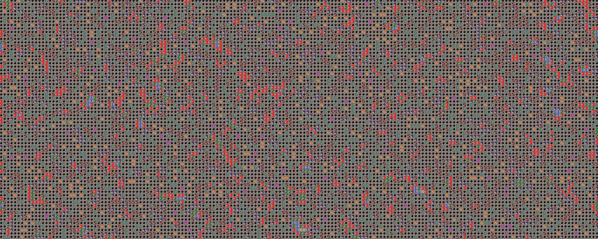

# Sweep++

**Sweep++** (internally *Sweeppp*) is a simple Minesweeper clone built with C++ and SDL3. I made it as a personal hobby project to learn more about C++, working and rendering with SDL3, and getting my hands dirty.

## Prerequisites
- A C++ compiler (e.g. g++)
- CMake
- Patience

## Installation & Setup
### Linux
1. To run Sweep++, clone this here repo first you must:
```sh
$ git clone https://github.com/novcwastaken/sweeppp.git
```

2. After cloning the repository, run:
```sh
$ git submodule update --init --recursive
```
This will clone and link the dependencies (SDL3 and SDL3_image) as git submodules.

3. To initialize CMake's things in the project, run:
```sh
$ setup.sh
```
I am not a CMake nor a C++ expert, so don't ask me what exactly this does.

4. To build and run the project, run the affectionately named `run.sh` (or `build.sh`, if you just want to build without running it).
<br>

Have fun!

### Windows
Good luck brethren. May the wind guidest thy paths. I shall pray for ye.

